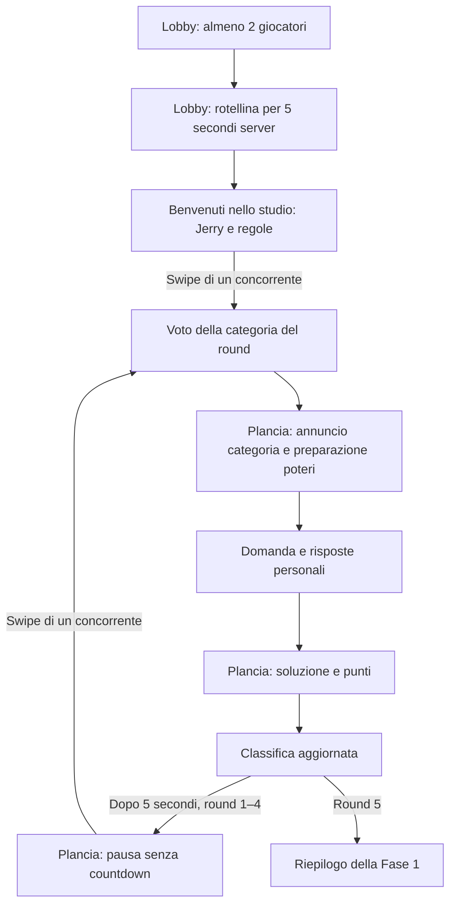

# Piano di implementazione — Fase 1 del gioco

Data: 26 ottobre 2026.
Ultimo aggiornamento: 28 ottobre 2026.
Stato: piano autorizzato il 26 ottobre 2026 con «procedi col piano». Implementata la Fase 1 sul frontend e sul coordinatore esistenti; l'utente ha inoltre richiesto l'importazione nel database di cataloghi di domande da internet. Le sezioni sotto conservano la distinzione originaria fra requisiti e default proposti; questi ultimi sono stati applicati come configurazione iniziale dell'implementazione. Prove visive sui telefoni a cura dell'utente.
Riferimenti: [memoria di progetto](../../PROJECT_MEMORY.md), [modulo home e stanze](01-menu-e-stanze.md).

Aggiornamento del ritmo richiesto il 26 ottobre 2026: istruzioni e avvio dei round sono manuali, senza scadenza. Un pulsante da trascinare, disponibile a qualsiasi concorrente attivo, fa proseguire tutta la partita. Restano i 5 secondi della classifica e gli attuali timer di voto e domanda. Questa decisione sostituisce l'introduzione automatica di 10 secondi e il passaggio automatico dalla classifica al voto successivo.

Aggiornamento richiesto il 27 ottobre 2026: Jerry commenta gli eventi notevoli con nickname e tono sbruffone; prima di ogni domanda si possono usare quattro tipi di poteri contro gli avversari. Taratura accettata: singolo bersaglio, massimo un effetto subito per domanda, probabilità di ricevere un potere dal 20% per il primo al 60% per l'ultimo. Il countdown iniziale resta di cinque secondi sul server, ma tutti attendono nella lobby con una rotellina e poi passano a «Benvenuti nello studio». Le aggiunte sono implementate: superati 98 test senza listener di rete e controllo TypeScript. Nessuna nuova dipendenza o migrazione SQL. Build completa non ripetuta dopo il limite della sandbox già documentato; le prove visive sui telefoni e la taratura dei poteri restano al proprietario.

Ulteriore richiesta del 27 ottobre: più tempo per la scelta di potere/bersaglio e avatar nel menu dei bersagli. Nuovo default di preparazione: 15 secondi rispetto agli 8 iniziali, con chiusura anticipata invariata. Il menu accessibile riusa Base UI e gli avatar Kenney già installati, con nickname e posizione.

Ulteriore richiesta del 27 ottobre: Shuffle sostituisce Lucchetti. Ogni 1.000 ms le risposte cambiano posizione sul telefono colpito, senza cambiare testo, ID o correttezza. Si riusa l’orologio della domanda, con ordine ricostruibile dopo rientro; al riavvio i vecchi `locks` persistiti vengono convertiti in `shuffle` senza perdere carte o bersagli. Controllo TypeScript e 100 test senza listener di rete superati; le prove UI e la taratura sul telefono restano al proprietario.

Taratura successiva del 27 ottobre: su richiesta del proprietario Shuffle passa da 0,5 a 1 secondo tra gli scambi di posizione. Il nuovo valore sostituisce quello iniziale.

Richiesta del 28 ottobre: rendere esplicito il voto democratico, mostrando avatar e conteggi sulle categorie e facendo distruggere e uscire di scena le due perdenti. Il proprietario chiarisce che la sequenza completa deve durare 2,5 secondi, sostituendo l'interpretazione di 5 secondi. La presentazione dell'esito usa `category_reveal`, con voti individuali pubblicati solo dopo la chiusura; i poteri restano subito utilizzabili e non cambiano le finestre server. Le regole rimangono un voto per concorrente, vittoria della categoria più votata e sorteggio esplicito in caso di parità o astensione. Le prove da interfaccia restano al proprietario.

Aggiornamenti d'implementazione: lo stato autorevole e lo storico dei round sono salvati come JSONB in `kb_matches`, nella stessa transazione delle ricevute, usando la coda e il blocco database già esistenti. Categorie e domande sono in tabelle dedicate. La rosa della partita è indipendente dalla lista dei posti della lobby. A fine fase l'organizzatore può riportare il gruppo in lobby conservando il record concluso; il nuovo avvio crea una nuova partita. Le domande troppo lunghe per il timer vengono conservate nel database ma escluse dall'estrazione. Cataloghi, licenze e filtri sono documentati in [src/server/content/README.md](../../web/src/server/content/README.md).

## 1. Obiettivo e requisiti confermati

Estendere la lobby esistente fino a una prima fase trivia completa, giocabile e sincronizzata su ogni telefono. Conservare nickname, avatar Kenney, stanze private e sessione ospite già implementati.

Sono confermati dal proprietario:

- Pulsante **«Inizia partita!»** nella stanza e possibilità di avvio con almeno **2 giocatori**, fino al massimo già previsto di 10.
- Attesa iniziale di **5 secondi** governata dal server, con una semplice rotellina nella stessa lobby per tutti; poi compare **«Benvenuti nello studio»**. Questa richiesta del 27 ottobre sostituisce il countdown numerico visibile.
- Conduttore televisivo **Jerry**, rappresentato dal PNG fornito nel progetto, che presenta il gioco e spiega le regole sulla plancia.
- Classifica dei punti disponibile nel client di ogni giocatore.
- Cinque round di cultura generale, con punti per correttezza e rapidità.
- Votazione della sottocategoria **all'inizio di ogni round, incluso il primo**; questa precisazione aggiorna la precedente sequenza che collocava il voto dopo la domanda.
- Voto democratico chiaramente spiegato, avatar sulle categorie votate ed eliminazione animata delle due categorie perdenti, richiesti il 28 ottobre.
- Categorie riconoscibili, per esempio animali, arte, sport, film e storia. Il catalogo completo rimane da definire.
- Tre viste alternate: **plancia**, **scelta della categoria**, **risposta alla domanda**. Il proprietario ha chiarito che «votazione», nell'elenco iniziale delle schermate, indica la scelta della risposta personale; non esiste un secondo voto sulla categoria.
- Plancia intesa anche come scena principale dello show: presentazione, regole, momenti collettivi, esiti e classifica.
- Nessun countdown per leggere le istruzioni o aspettare l'avvio del prossimo round: basta lo swipe di un qualsiasi concorrente per proseguire tutti insieme. Mantenere classifica di 5 secondi e timer attuale delle domande.
- Jerry commenta a fine round il primo spodestato, nessuna o tutte risposte corrette e l'ultimo che sbaglia ancora, usando i nickname quando menziona qualcuno e un tono sbruffone nelle prese in giro.
- Quattro poteri diversi e bilanciati da usare nella preparazione di ogni domanda; una carta casuale iniziale consumabile, poi probabilità `p × k` di riceverne altre, crescente dal primo all'ultimo in classifica. Tra gli effetti richiesti: lettere interne delle risposte invertite, con prima e ultima ferme.
- Prima taratura dei poteri accettata: un solo avversario per uso, massimo un effetto subito per domanda, probabilità di acquisizione dal 20% per il primo al 60% per l'ultimo.

La richiesta esplicita del 27 ottobre sostituisce il precedente riferimento ai «jolly rimanenti» come semplice esempio. Il dettaglio dei quattro effetti e gli altri limiti operativi sotto sono scelte d'implementazione, distinte dalla taratura accettata dal proprietario.

Questo modulo non comprende minisfide della Fase 2, percorso e maledizioni della Fase 3, profili, nuove scelte di hosting, doppiaggio o generazione di altre immagini. La classifica della Fase 1 non assegna la vittoria dell'intera partita.

## 2. Base esistente verificata

Ispezione statica del 26 ottobre 2026; percorsi dell'app relativi a `web/`.

| File o area | Stato attuale e intervento previsto |
| --- | --- |
| `src/features/rooms/components/room-lobby.tsx` | Elenco partecipanti e organizzatore, invito, modifica identità e uscita; aggiungere comando di avvio, condizioni e attesa |
| `src/features/rooms/components/room-access-panel.tsx` | Gestisce accesso e compone la lobby; delegare la scelta tra menu, lobby e partita a un contenitore della sessione |
| `src/app/page.tsx` | Oggi dispone la lobby nel pannello della home accanto alla presentazione; predisporre una scena di gioco a tutta pagina, senza limitare domanda e plancia alla card da 480 px |
| `src/features/rooms/types.ts` | `RoomSnapshot` conosce soltanto `waiting` e `closed`; estendere il contratto per la partita e distinguere dati pubblici e personali |
| `src/features/rooms/services/room-client.ts` e `hooks/use-room-connection.ts` | Socket unico, comandi con ricevute, recupero sessione, versioni e controllo fra schede; riusare queste garanzie anche per il gioco |
| `src/server/index.ts` | Custom server Next.js/Socket.IO e pubblicazione di snapshot personalizzati; registrare comandi e aggiornamenti della partita |
| `src/server/lobby.ts` | Autorità sulla stanza, coda delle operazioni, rientro e scadenze; integrare avvio atomico e distinguere ciclo di vita lobby/partita |
| `src/server/database.ts` | PostgreSQL/PGlite già presenti; vincolo SQL degli stati limitato a `waiting`/`closed`, da aggiornare con migrazione incrementale |
| `src/server/shutdown.ts` | Arresto e drenaggio del servizio lobby già presenti; includere scheduler e operazioni della partita prima della chiusura del database |
| `src/server/*.test.ts` | Test di lobby, integrazione e arresto; estenderli con il flusso di gioco e conservare le verifiche precedenti |
| `src/app/globals.css` e `package.json` | Tailwind, daisyUI con prefisso `daisy-` e `tw-animate-css` già presenti; partire da questa base per scena e animazioni |

**Risorsa del conduttore verificata:** il file effettivo è [`Gerry.png`](../../Gerry.png), nella radice del progetto, mentre il nome richiesto per il personaggio è Jerry. È un PNG RGB di 1215 × 1295 px, circa 2,38 MB, con sfondo arancione incorporato e senza trasparenza. Per la prima versione proporre un riquadro scenico che includa lo sfondo; non assumere uno scontorno già disponibile. In implementazione conservare l'originale e preparare una copia web ottimizzata, per esempio in `public/hosts/jerry/`, verificando leggibilità e tempi di caricamento.

Non serve un secondo frontend o un secondo server realtime. L'eventuale necessità di altre dipendenze va verificata durante l'implementazione; nessuna nuova libreria di animazione è un prerequisito di questo piano.

## 3. Le tre viste e la regia di Jerry

Le tre viste sono modalità della stessa partita governate dallo stato del server. Non sono pagine tra cui ogni giocatore può navigare liberamente facendo avanzare il proprio round.

| Vista | Contenuti e comportamento |
| --- | --- |
| **Plancia / studio** | Jerry, messaggio del conduttore, fase e round, classifica con avatar e nickname, proprio punteggio e variazioni del round. Ospita introduzione, regole, annuncio categoria e preparazione con poteri, soluzione e riepilogo |
| **Scelta della categoria** | Sottocategorie candidate uguali per tutti, scelta personale, conferma e tempo residuo; esito comune prima della domanda |
| **Risposta alla domanda** | Domanda e alternative di base uguali per tutti, con l'eventuale effetto personale ricevuto, tempo residuo, scelta personale e conferma di ricezione. Dopo l'invio mostra attesa ed eventuale conteggio dei partecipanti che hanno risposto, senza rivelare le loro scelte |

Un'intestazione compatta accompagna le viste: round `1/5`, punteggio personale, connessione e accesso alla classifica. La classifica completa deve restare consultabile sul telefono senza interrompere il timer; nella plancia è in evidenza, durante la domanda può aprirsi in un pannello. Il tempo disponibile e le risposte hanno priorità sullo spazio occupato dal conduttore.

Jerry introduce il gioco, spiega voto, risposta e punti, annuncia round/categoria, commenta l'esito e accompagna il riepilogo. **Proposta:** testi brevi in balloon o cartelli, associati a identificativi di scena e leggibili senza audio. Il PNG può entrare con rimbalzo, oscillare leggermente o reagire con un piccolo zoom; una singola immagine non implica animazione del volto, voce o sincronizzazione labiale.

**Commenti confermati il 27 ottobre.** Jerry usa i nickname e un tono sbruffone per commentare eventi reali del round: cambio al vertice, nessuna risposta corretta, tutte corrette o errore ripetuto di chi era ultimo. **Scelta operativa:** regole pure sul server scelgono al massimo due battute originali condivise e persistite per round; confronto dei punteggi precedenti/attuali e distinzione fra errore e mancata risposta impediscono attribuzioni sbagliate. Le battute restano leggibili nell'esito, nella classifica e nella pausa successiva. Non servono servizi AI o voce.

**Direzione delle transizioni proposta:** tendina da quiz televisivo, cartelli che entrano lateralmente e scatto della classifica. L'attesa iniziale usa soltanto la rotellina nella lobby. Durata indicativa 250–450 ms per i cambi di vista; tutte le durate sono configurabili salvo i 5 secondi richiesti per l'attesa iniziale. Le animazioni non aprono o chiudono le finestre di risposta: la loro conclusione non deve essere necessaria al server per avanzare. Nessuna domanda diventa rispondibile mentre è ancora nascosta da una transizione.

Prevedere precaricamento del conduttore durante la lobby, fallback testuale se l'immagine non arriva, focus coerente dopo i cambi di vista, pulsanti comodi al tocco e alternativa con movimento ridotto. Il caricamento di un'immagine su un singolo telefono non blocca l'intera stanza.

## 4. Sequenza della partita

La plancia raggruppa più momenti dello show; non occorrono altre schermate principali per presentazione e risultati. Ogni ripetizione del voto riguarda il round che sta per iniziare. Dopo il quinto round non si apre un voto privo di destinazione.

### Avvio dalla room

**Proposta di permessi:** soltanto l'organizzatore vede il pulsante attivo; gli altri leggono che la partita attende l'avvio. Con una sola persona, mostrare «Servono almeno 2 giocatori». Non aggiungere uno stato «Pronto» obbligatorio senza una decisione specifica.

**Proposta sul conteggio:** richiedere almeno 2 partecipanti effettivamente connessi, e fissare all'avvio la rosa dei partecipanti connessi. I posti riservati a chi è offline non rendono da soli avviabile la partita. Minimo 2 è confermato; conteggio dei disconnessi e permesso del solo organizzatore sono proposte.

Il server deve eseguire in una sola operazione coerente verifica dei permessi, controllo dei partecipanti, fissazione della rosa, creazione della partita, chiusura dei nuovi ingressi e pubblicazione del countdown. Un ingresso simultaneo o un doppio tocco non possono creare due partite o rose differenti. I partecipanti temporaneamente offline ed esclusi dalla rosa ricevono un messaggio esplicito al ritorno e possono lasciare la stanza; non ricevono comandi di gioco o un posto retroattivo.

**Proposta:** fissare nickname e avatar della rosa per tutta la partita e consentirne la modifica soltanto in lobby. Il server deve respingere `room:update` durante countdown e partita, anche se il comando arriva da un vecchio pannello rimasto aperto.

Il countdown usa una scadenza comune di 5 secondi. L'interfaccia rimane nella lobby con la rotellina «Jerry sta preparando lo studio…», senza secondi visibili e senza passare ancora alla scena di gioco. Durante l'attesa nasconde modifica identità e avvio; conserva uscita, riconnessione e trasferimento del controllo fra schede. Anche un editor già aperto non permette modifiche durante la preparazione. Alla scadenza il server passa a `intro` e tutti vedono «Benvenuti nello studio».

Se, prima della conclusione, i partecipanti connessi della rosa scendono sotto 2, l'avvio viene annullato e si torna alla lobby disponibile, senza punti. La soglia viene ricontrollata al termine; la disconnessione dopo l'effettivo avvio segue le regole della partita, non riapre il countdown. Soglia, annullamento e ricevute idempotenti dell'avvio restano quelli già applicati.

### Ogni round

1. Il server propone le sottocategorie disponibili, aprendo il voto per tutti. Al primo avvio assegna una carta casuale a testa; nei round 2–5 esegue un'estrazione aggiuntiva secondo classifica e spazio nell'inventario.
2. Raccoglie un voto personale e determina la categoria; Jerry ne annuncia l'esito.
3. Durante l'annuncio ogni concorrente può usare un potere su un avversario o passare. Seleziona una domanda valida non ancora usata nella partita e prepara una finestra di risposta comune successiva all'annuncio e alla transizione.
4. Pubblica testo e opzioni con eventuale effetto personale; ciascun giocatore invia la propria risposta. Il server conferma l'accettazione senza anticipare correttezza o punti.
5. Alla chiusura, rivela la soluzione, attribuisce i punti e salva il risultato una sola volta.
6. Jerry commenta gli eventi notevoli. La plancia mostra punti guadagnati e classifica per 5 secondi. Dopo il quinto round passa al riepilogo; altrimenti resta in pausa senza scadenza, con battute ancora leggibili, e lo swipe di un concorrente apre il voto del round successivo per tutti.

## 5. Regole proposte per rendere il piano eseguibile

Questi valori sono i **default iniziali del piano**, successivamente applicati e modificati. L'aggiornamento manuale di istruzioni e avvio dei round, i 5 secondi della classifica e il mantenimento del timer delle domande sono ora confermati dal proprietario. Gli altri valori restano scelte operative da bilanciare.

| Aspetto aperto | Proposta per la prima versione |
| --- | --- |
| Introduzione di Jerry | Jerry spiega le regole essenziali senza countdown; qualsiasi concorrente può trascinare il pulsante per saltare le istruzioni e aprire il voto del primo round |
| Categorie per votazione | 3 candidate, estratte tra quelle con domande ancora disponibili |
| Durata del voto | 12 secondi; chiusura anticipata se tutti i partecipanti ancora in gara hanno confermato |
| Modifica del voto | Selezione locale modificabile fino alla conferma; primo voto confermato definitivo |
| Maggioranza | Vince la categoria con più voti, senza ballottaggio |
| Parità e astensioni | Sorteggio server fra le più votate; se nessuno vota, fra tutte le candidate. Conservare e comunicare il risultato del sorteggio |
| Annuncio e preparazione dei poteri | Riusa `category_reveal`: da 3 a un massimo di 8 secondi sulla plancia; chiusura anticipata se tutti i concorrenti ancora in gara usano un potere o passano |
| Risposte | 4 alternative con una sola corretta; una risposta confermata per giocatore e round |
| Durata della domanda | 15 secondi dal comune istante di apertura; chiusura anticipata se tutti i partecipanti ancora in gara hanno risposto |
| Risposta errata o assente | 0 punti, senza sottrazioni |
| Risposta corretta | 500 punti base + bonus velocità da 0 a 500, calcolato sul tempo di arrivo al server |
| Soluzione e classifica | 5 secondi per soluzione/esito e 5 per classifica; poi pausa senza scadenza prima del prossimo round, aperto con swipe di un concorrente |
| Pari punti in classifica | Stessa posizione; ordine visivo stabile di ingresso, senza spareggio implicito |
| Fine Fase 1 | Riepilogo fermo con punti conservati, senza avviare Fase 2 e senza proclamare il vincitore finale |

Formula candidata per una risposta corretta: `500 + floor(500 × clamp(1 − elapsedMs / answerDurationMs, 0, 1))`. `elapsedMs` deriva dall'apertura comune e dal timestamp di ricezione registrato dal coordinatore, non da un valore inviato dal telefono. Le risposte ricevute alla scadenza o oltre sono rifiutate. La chiusura anticipata non ricalcola il bonus su una durata più breve. La latenza resta parte del tempo osservato: nessuna compensazione basata sull'orologio dichiarato dal client.

La formula favorisce prima la correttezza e poi la rapidità; peso del bonus e durate vanno valutati giocando. L'eventuale ritorno collettivo in lobby dopo il riepilogo è una scelta da definire: non azzerare automaticamente i punti né sovrascrivere la partita conclusa.

### Poteri: scelte operative del 27 ottobre

I quattro effetti seguenti concretizzano la richiesta, senza attribuire al proprietario la scelta di nomi o dettagli ulteriori:

| Potere | Effetto durante la domanda corrente |
| --- | --- |
| Lettere ribelli | Inverte le lettere interne delle parole delle risposte, mantenendo prima e ultima lettera; non altera gli ID delle opzioni |
| Nebbia | Copre le alternative: un tocco su ciascuna la rivela prima di permetterne la scelta |
| Shuffle | Scambia tutte e quattro le risposte di posizione ogni secondo sul solo telefono del bersaglio, mantenendo gli ID delle opzioni e la selezione personale |
| Riflettore | Mostra un'alternativa alla volta con navigazione fra le quattro |

Una carta casuale iniziale per ogni concorrente, inventario massimo di due carte, al massimo un uso per round. Ogni uso consuma la carta e colpisce un solo avversario ancora in gara; nessuno può subire più di un effetto nella stessa domanda. Gli effetti non cambiano la soluzione, il timer comune o la formula dei punti e si esauriscono con la domanda.

Dal round 2 al round 5 il server può assegnare un'altra carta, se l'inventario ha spazio, con `p = 0,2` e `k = 1 + 2 × (rango − 1) / (N − 1)`. `N` conta solo i concorrenti non ritirati; pari punti danno lo stesso rango e la stessa probabilità. L'intervallo dal 20% al 60%, singolo bersaglio e limite di un effetto subito sono la taratura accettata; formula lineare, limite dell'inventario, un uso per round, round di estrazione e finestra massima di 15 secondi sono default tecnici da bilanciare.

Il server convalida fase, round/istanza, disponibilità della carta e bersaglio, consuma e salva una volta sola, e impedisce reinvii o sorteggi ripetuti al rientro. Inventario e avanzamento dell'effetto sono personali. I nuovi match supportano i poteri; i vecchi salvataggi senza inventario continuano senza assegnazioni retroattive a metà gara. I nuovi campi opzionali nel JSONB della partita non prevedono una nuova migrazione SQL. Il bilanciamento fra i quattro effetti richiede prove di gioco; questa configurazione non ne dimostra ancora l'equivalenza.

### Domande e categorie

Proporre un primo catalogo in italiano coerente con animali, arte, sport, cinema e storia, estendibile a geografia, scienze, musica e altre sottocategorie di cultura generale. Lingua iniziale, difficoltà e dimensione del catalogo sono ancora da consolidare; la lingua inglese della home non obbliga a cambiare tutto il sito in questo modulo.

Preparare contenuti redazionali versionati con identificativo, categoria, testo, opzioni con ID stabili, soluzione, breve spiegazione, fonte e data di verifica. Conservare nel round la versione effettivamente utilizzata. Domande e soluzioni devono essere verificate prima di inserirle nel catalogo: non serve generazione in tempo reale durante la partita.

Il seed deve coprire cinque round senza ripetizioni anche se viene scelta ripetutamente la stessa categoria. Non proporre categorie esaurite; se il catalogo non consente di completare il ciclo, bloccare l'avvio con un errore comprensibile, anziché fermarsi a metà. Il numero effettivo di candidate può diminuire solo secondo una regola configurata ed esplicita. Il catalogo con le soluzioni rimane sul server e non viene importato in componenti client o distribuito in `public/`.

## 6. Coordinamento, dati e protocollo

**Architettura proposta:** estendere il coordinatore esistente con una macchina a stati della partita, mantenendo un solo processo autorevole. Tempi, categorie, domande, punteggi e progressione sono decisi dal server. Il telefono invia intenzioni e rappresenta lo stato ricevuto.

Separare lo stato della stanza (`waiting`, `starting`, `playing`, `closed`) dallo stato dettagliato della partita. Gli stati di gioco sono `countdown`, `intro`, `round_ready`, `category_vote`, `category_reveal`, `question`, `round_reveal`, `scoreboard`, `phase_complete`, oltre agli stati tecnici `suspended`/`aborted`. `intro` e `round_ready` non hanno scadenza. I nomi sono scelte tecniche, non schermate principali aggiuntive richieste al giocatore.

| Dato proposto | Responsabilità |
| --- | --- |
| Partita | Stanza, configurazione/versione, stato, round, versione dello snapshot e scadenze |
| Giocatori della partita | Rosa stabile con ID, identità iniziale, presenza, abbandono e punteggio totale; separata dal posto attivo nella lobby |
| Round | Indice 1–5, candidate, categoria scelta ed esito; istanze della domanda con ID, versione dei contenuti, apertura/chiusura e stato valido/annullato |
| Voti | Un voto accettato per partita/round/giocatore; il sorteggio è un risultato persistito |
| Risposte | Opzione, istante server di ricezione, accettazione ed esito; vincolo univoco per partita/istanza della domanda/giocatore |
| Punti del round | Correttezza, quota base, bonus e totale; vincolo che impedisca una seconda assegnazione |
| Poteri e preparazione | Inventario personale, estrazioni già effettuate, carta consumata, bersaglio, effetto della domanda e avanzamento personale; salvati nel JSONB opzionale della partita |
| Commenti di Jerry | Al massimo due battute condivise per round, calcolate dagli esiti e conservate fino alla pausa successiva |
| Ricevute | Identificativo richiesta, partecipante, stanza/partita/round/istanza pertinenti, impronta dei parametri ed esito; reinvii riconoscibili |

Introdurre migrazioni SQL versionate applicabili anche a database PGlite già popolati: il solo `CREATE TABLE IF NOT EXISTS` attuale non modifica il vincolo degli stati. Conservare stanze e sessioni esistenti e verificare la migrazione anche sul percorso PostgreSQL esterno.

**Comandi:** `game:start`, `game:continue`, `game:vote-category`, `game:answer`, `game:resume`, `game:return-lobby`; l'abbandono riusa `room:leave`. Ogni azione mutante porta `requestId` e gli identificativi pertinenti: l'avvio si riferisce alla stanza, mentre partita e round sono assegnati dal server. `game:continue` include partita, round e fase attesa (`intro` o `round_ready`); è ammesso a qualsiasi concorrente attivo e connesso con controllo della scheda, con almeno due connessi. Due swipe simultanei o un comando obsoleto non possono saltare scene. Il voto si riferisce a partita e round; la risposta include anche `questionInstanceId`, così un reinvio non può colpire una domanda sostitutiva. Il server ricava il giocatore dalla sessione già autenticata e controlla anche il possesso della scheda attiva. Separare la convalida di questi comandi da quella delle operazioni lobby che richiedono nickname/avatar. La versione va usata per rilevare azioni obsolete senza rifiutare un voto valido solo perché un altro giocatore ha appena aggiornato lo stato.

**Estensione poteri del 27 ottobre:** `game:use-power` usa carta e bersaglio, `game:ready-question` conclude la propria preparazione senza usare una carta, `game:clear-power` registra i tocchi necessari per l'effetto personale. Ricevute e identificativi di preparazione/domanda impediscono di ripetere consumi, saltare i vincoli o applicare un comando alla domanda successiva. Non serve un nuovo trasporto o processo server.

**Snapshot indicativo:** partita e stanza, fase, round, istanza della domanda, versione, `serverNow`, apertura/scadenza, scena di Jerry, classifica, informazioni pubbliche del round e dati del solo destinatario (`selfVote`, `selfAnswer`, conferme ed esito personale quando rivelabile). Riusare il socket esistente e una pubblicazione personalizzata, senza avviare una connessione indipendente per ogni schermata.

Prima della rivelazione non inviare soluzione, correttezza, punti del round o risposte degli altri, nemmeno nelle ricevute o negli eventi di riconnessione. I conteggi aggregati di chi ha votato/risposto possono essere pubblici. **Implementazione aggiornata il 28 ottobre:** totali e scelte individuali per categoria restano nascosti fino alla chiusura del voto; dopo la scelta, `categoryVoters` associa ogni categoria agli ID stabili dei concorrenti già presenti nella rosa, per visualizzarne gli avatar. La proiezione deriva dai voti già salvati e non richiede migrazioni SQL. La classifica durante la domanda rimane quella dei round già conclusi.

Le operazioni di lobby e partita devono condividere la stessa disciplina di serializzazione e transazione; due code indipendenti non proteggono dall'ingresso contemporaneo all'avvio. Salvataggio, ricevuta e avanzamento precedono la conferma e la pubblicazione. Aggiungere vincoli sul database come ultima protezione contro duplicazioni di voto, risposta o punti.

Timer e risposta in arrivo vicino alla scadenza devono essere ordinati coerentemente dal coordinatore: registrare il tempo all'ingresso dell'azione, ricontrollare stato e finestra nella coda condivisa e risolvere il confine una sola volta. I timer usano identificativo e versione della fase, così un vecchio callback non chiude il round successivo.

I client stimano la differenza dal tempo server mediante sincronizzazione con misurazione dell'andata/ritorno, aggiornandola al rientro e al ritorno in primo piano. Il conto alla rovescia è visivo; non determina accettazione o punti. Un evento perso si recupera con uno snapshot attuale, senza riprodurre forzatamente tutte le animazioni saltate.

## 7. Disconnessioni, abbandono e riavvio

Il comportamento attuale della lobby scade i posti offline dopo 90 secondi e restituisce snapshot solo per stanze `waiting`. Non basta aggiungere un pulsante: `resume`, snapshot, trasferimento della scheda, scadenze e pulizia devono conoscere lo stato di partita.

**Proposte per la prima versione:**

- La rosa, i punti e i risultati della partita non vengono cancellati dalla pulizia delle partecipazioni lobby. Chi rientra con la stessa sessione valida conserva il proprio ID e raggiunge lo stato attuale, anche oltre la riserva lobby di 90 secondi.
- Vietare nuovi ingressi dopo l'inizio del countdown; ammettere soltanto il rientro dei giocatori fissati nella rosa. Distinguere il messaggio «partita già iniziata» da «stanza inesistente».
- Una disconnessione temporanea dopo l'avvio non ferma il timer di voto o domanda; il giocatore resta atteso fino alla scadenza. Le risposte già accettate rimangono valide. Senza risposta entro il termine, il round assegna 0 punti.
- L'uscita esplicita marca un abbandono e disabilita le azioni successive; conserva il punteggio e la riga in classifica. Non consente il reinserimento tardivo nella stessa partita come nuovo concorrente.
- Nelle finestre temporizzate la partita avanza automaticamente. Prima del round successivo resta in pausa manuale: per il nuovo swipe servono almeno due concorrenti della rosa **connessi e non ritirati**. Gli offline temporanei conservano il posto ma non soddisfano la soglia. La pausa non scade e il rientro del secondo concorrente non apre automaticamente il round. Per la sospensione tecnica delle altre fasi rimane il limite operativo di 90 secondi.
- Se tutti sono offline, completare la finestra già aperta e raggiungere la pausa manuale prima del prossimo round; non consumare cinque round senza nessuno presente. Il limite di inattività della lobby non deve chiudere una partita in modo accidentale.

**Proposta per il riavvio del server:** caricare prima le migrazioni, poi lo stato salvato, riconfermare le presenze e riprendere una sola volta ogni transizione. Una domanda con esito già salvato mantiene esito e punti; un conteggio o annuncio non ancora concluso può essere riprogrammato. Una domanda aperta al momento dell'arresto non deve ripartire con lo stesso testo già visto e un nuovo bonus tempo: proporre l'annullamento dell'istanza, senza assegnarle punti e conservando le ricevute per l'audit, e una nuova domanda della stessa categoria dopo il rientro di almeno due giocatori. L'indice del round resta uguale, ma cambia `questionInstanceId`: un vecchio reinvio viene riconosciuto come relativo all'istanza annullata, non accettato nella sostitutiva. Il voto di categoria già concluso resta valido; se era ancora aperto, conservare i voti accettati e riproporre una scadenza comune dopo il rientro. Questa politica richiede una riserva di contenuti e test specifici; se manca una domanda sostitutiva, mostrare uno stato di interruzione esplicito anziché inventare risultati.

La politica di riavvio, le finestre di attesa e il trattamento degli abbandoni sono decisioni di prodotto aperte. Vanno fissate prima di considerare completo il recupero della partita.

## 8. Suddivisione del lavoro futuro

I seguenti percorsi sono proposti e relativi a `web/`; crearli solo quando ospitano responsabilità effettive.

| Area | Responsabilità |
| --- | --- |
| `src/features/session/` | Contenitore client comune per menu, lobby e scena di partita; unico proprietario della connessione |
| `src/features/game/types.ts` | Contratti pubblici, snapshot personali e comandi tipizzati |
| `src/features/game/components/` | Scena di gioco, Jerry e commenti, plancia/classifica, voto categoria, preparazione poteri, domanda con effetti personali ed esiti |
| `src/features/rooms/components/room-lobby.tsx` | Rotellina durante i cinque secondi iniziali, permanenza nella lobby e blocco temporaneo della modifica identità/nuovo avvio |
| `src/features/game/hooks/` | Derivazione delle viste dallo snapshot e tempo sincronizzato, senza calcolo autorevole dei punti |
| `src/features/game/styles/` | Transizioni della scena, adattamento mobile e movimento ridotto, se serve un foglio dedicato |
| `src/server/game/` | Regole pure, macchina a stati, scheduler, servizio/repository e selezione dei contenuti |
| `src/server/content/` | Catalogo iniziale privato, validazione e seed delle domande |
| `src/server/migrations/` | Evoluzione incrementale del database esistente |
| `public/hosts/jerry/` | Copia web del PNG del conduttore, originale conservato nella radice |

### Ordine di implementazione

1. **Consolidare i default aperti.** Registrare permesso di avvio, conteggio connessi, voto, tempi, punteggio, poteri e recupero. Risultato: una configurazione iniziale esplicita, senza trasformare proposte in requisiti confermati.
2. **Preparare contenuti e contratti.** Modellare domanda, opzioni, categorie, stati e proiezioni pubbliche/personali; validare il catalogo. Risultato: cinque round eseguibili senza esaurire le domande e senza esporre le soluzioni.
3. **Estendere persistenza e ciclo di vita.** Migrare i vincoli, creare rosa stabile, voti, risposte, ricevute e punti; adattare pulizia e rientro. Risultato: i dati della partita sopravvivono a rete e scadenze della lobby.
4. **Realizzare avvio e countdown.** Collegare «Inizia partita!», avvio atomico, chiusura ingressi, attesa comune con rotellina nella lobby e annullamento prima della partenza. Risultato: almeno due client raggiungono «Benvenuti nello studio» una sola volta.
5. **Realizzare il motore dei cinque round.** Voto, scelta domanda, scadenze, accettazione risposta, soluzione e punteggio. Risultato: ciclo completo verificabile senza dipendere dalle animazioni.
6. **Comporre le tre viste e Jerry.** Integrare la scena a tutta pagina, regole, classifica e pannelli personali; rifinire caricamento e transizioni cartoon. Risultato: intera esperienza leggibile e utilizzabile da telefono.
7. **Completare continuità e riepilogo.** Coprire refresh, doppia scheda, abbandono, riavvio e conclusione della sola Fase 1. Risultato: nessuna perdita o duplicazione di risultati e nessun ingresso nelle fasi successive.
8. **Verificare il modulo.** Eseguire controlli automatici e consegnare la checklist mobile al proprietario; correggere gli esiti osservati. Le prove in browser e l'avvio di server restano soggetti alla precedente indicazione dell'utente: non avviarli senza una nuova richiesta.

Le attività 2–5 hanno dipendenze sequenziali sul modello autorevole. La preparazione del PNG e della scena visiva può procedere in parallelo una volta fissati i contratti, senza simulare la progressione come comportamento finale.

## 9. Criteri di accettazione e verifiche future

**Avvio e sincronizzazione:** con 1 giocatore non si parte; con 2 si può avviare, fino a 10. Comando di un non autorizzato, doppio tocco, ingresso simultaneo all'avvio, disconnessione nel countdown e perdita della conferma hanno esito unico e coerente. Il countdown dura 5 secondi secondo il server e non si riavvia su refresh.

**Attesa nella lobby:** durante i cinque secondi host e ospiti restano nella stessa lobby con rotellina accessibile, senza numeri. Alla scadenza compare «Benvenuti nello studio». Verificare editor già aperto, cancellazione per perdita della soglia, uscita, riconnessione e trasferimento fra schede senza sbloccare modifiche durante l'avvio.

**Round e voto:** esattamente cinque round e cinque votazioni iniziali, compreso il primo. Istruzioni e pause prima del round non avanzano col tempo; lo swipe di un concorrente diverso dall'organizzatore fa proseguire tutti, mentre swipe simultanei, ripetuti o vecchi non saltano scene. Verificare ripresa delle pause dopo riavvio, perdita/rientro del secondo concorrente, parità, nessun voto, categoria esaurita, doppio invio, voto per round precedente e chiusura anticipata. Tutti ricevono la stessa categoria, domanda e sequenza delle opzioni. Dopo il quinto round non parte un sesto voto.

**Risposte e punti:** verificare correttezza e bonus con orologio controllato; rifiutare invii anticipati, tardivi, opzioni inesistenti e tentativi successivi. Due richieste o la ripetizione di una ricevuta non assegnano punti due volte. La chiusura anticipata non cambia la formula. Totali, posizioni e parità sono uguali sui client.

**Poteri:** verificare carta iniziale, cap di due, massimo un uso per round, singolo bersaglio valido e massimo un effetto subito. Con sorteggio controllato coprire estremi 20%/60%, parità, ritirati, round 2–5, inventario pieno e nessuna nuova estrazione al rientro. Verificare preparazione di massimo 15 secondi e chiusura anticipata, consumo persistito, privacy, invii duplicati/obsoleti, quattro effetti senza alterare ID/soluzione/punti e ripristino dell'avanzamento personale. Per Shuffle coprire i confini di 1.000 ms, lo spostamento di tutte le risposte senza duplicati, la ricostruzione dopo rientro, la selezione per ID e la conversione dei vecchi Lucchetti. Vecchi match senza inventario continuano senza carte assegnate a metà gara. Questi sono criteri da verificare, non risultati già ottenuti.

**Jerry:** con esiti controllati coprire cambio di primo, tutti o nessuno corretti, ultimo che sbaglia ancora, parità, ritiro e mancata risposta. I nickname sono testo, le battute descrivono eventi effettivi, non superano due per round e rimangono uguali su tutti i client e dopo il recupero. Lettura, tono e varietà richiedono la prova del proprietario.

**Riservatezza:** ispezionare snapshot, ricevute, rientri e bundle client: nessuna soluzione o scelta altrui prima dell'esito. Un aggiornamento pubblico non deve confermare per errore un voto o una risposta personale ancora incerti; per questo estendere il riconoscimento delle conferme nell'hook attuale.

**Persistenza e continuità:** provare migrazione su database locale già popolato e nuovo, riapertura, reinvio dopo conferma persa, scadenza della riserva lobby in partita, doppia scheda, cambio organizzatore, abbandono e riavvio durante voto, domanda e salvataggio punti. Le ricevute restituite dopo il recupero devono essere compatibili con lo stato attuale. Separare la verifica PGlite da quella su PostgreSQL esterno, da riportare solo se effettivamente eseguita.

**Interfaccia mobile:** checklist per almeno due telefoni reali e una stanza con dieci partecipanti: testo leggibile, risposte sempre raggiungibili, classifica personale/completa, timer dopo cambio scheda, Jerry con immagine lenta o assente, movimento ridotto, focus e assenza di ostacoli delle animazioni agli input. Aggiungere uso/passaggio dei poteri, comprensione dei quattro effetti, lettura delle battute e rotellina iniziale. Provare stessa rete e reti diverse. Queste sono verifiche pianificate a cura del proprietario, non ancora eseguite dall'agente.

Per la futura implementazione usare clock e timer controllabili nei test del motore e prove d'integrazione sul protocollo; mantenere i test lobby/arresto, controllo TypeScript e build con controllo dei tipi attivo. Non occorrono test che replichino semplicemente il markup. La redazione di questo piano non richiede build, installazioni o avvio dell'app.

## 10. Decisioni ancora aperte

Permesso di avvio, partecipanti offline, maggioranza/parità, tempi, formula dei punti, catalogo italiano, recupero e ritorno in lobby hanno ora default applicati, descritti nella memoria di progetto. Restano da valutare con le prove difficoltà editoriale, ritmo e bilanciamento dei quattro poteri; limite di due carte, un uso per round, interpolazione della probabilità e preparazione di massimo 15 secondi sono scelte operative modificabili. Le fasi successive e l'eventuale voce di Jerry restano fuori da questo aggiornamento.

Il minimo di 2 giocatori, i 5 secondi iniziali ora rappresentati dalla rotellina nella lobby, il conduttore fornito con commenti personali, il ritmo cartoon, la classifica su ogni client, il voto categoria prima di ogni round e l'introduzione dei poteri con la taratura accettata sono confermati.

## Riferimenti tecnici consultati

Le ricevute persistenti e lo snapshot di recupero sono scelte applicative proposte anche perché Socket.IO non garantisce per impostazione predefinita la consegna di ogni evento: [garanzie di consegna](https://socket.io/docs/v4/delivery-guarantees/), consultato il 26 ottobre 2026. Il recupero automatico può fallire e richiede comunque riallineamento applicativo: [recupero della connessione](https://socket.io/docs/v4/connection-state-recovery/), consultato il 26 ottobre 2026.
