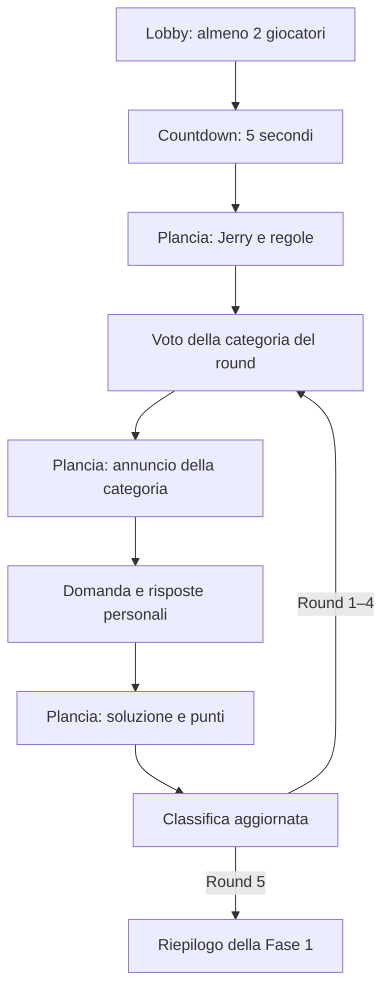

# Piano di implementazione — Fase 1 del gioco

Data: 26 ottobre 2026.
Stato: piano autorizzato il 26 ottobre 2026 con «procedi col piano». Implementata la Fase 1 sul frontend e sul coordinatore esistenti; l'utente ha inoltre richiesto l'importazione nel database di cataloghi di domande da internet. Le sezioni sotto conservano la distinzione originaria fra requisiti e default proposti; questi ultimi sono stati applicati come configurazione iniziale dell'implementazione. Prove visive sui telefoni a cura dell'utente.
Riferimenti: [memoria di progetto](../../PROJECT_MEMORY.md), [modulo home e stanze](01-menu-e-stanze.md).

Aggiornamenti d'implementazione: lo stato autorevole e lo storico dei round sono salvati come JSONB in `kb_matches`, nella stessa transazione delle ricevute, usando la coda e il blocco database già esistenti. Categorie e domande sono in tabelle dedicate. La rosa della partita è indipendente dalla lista dei posti della lobby. A fine fase l'organizzatore può riportare il gruppo in lobby conservando il record concluso; il nuovo avvio crea una nuova partita. Le domande troppo lunghe per il timer vengono conservate nel database ma escluse dall'estrazione. Cataloghi, licenze e filtri sono documentati in [server/content/README.md](../../pwa-homepage-design/server/content/README.md).

## 1. Obiettivo e requisiti confermati

Estendere la lobby esistente fino a una prima fase trivia completa, giocabile e sincronizzata su ogni telefono. Conservare nickname, avatar Kenney, stanze private e sessione ospite già implementati.

Sono confermati dal proprietario:

- Pulsante **«Inizia partita!»** nella stanza e possibilità di avvio con almeno **2 giocatori**, fino al massimo già previsto di 10.
- **Countdown di 5 secondi**, seguito da transizioni rapide e cartoonose verso la plancia di gioco.
- Conduttore televisivo **Jerry**, rappresentato dal PNG fornito nel progetto, che presenta il gioco e spiega le regole sulla plancia.
- Classifica dei punti disponibile nel client di ogni giocatore.
- Cinque round di cultura generale, con punti per correttezza e rapidità.
- Votazione della sottocategoria **all'inizio di ogni round, incluso il primo**; questa precisazione aggiorna la precedente sequenza che collocava il voto dopo la domanda.
- Categorie riconoscibili, per esempio animali, arte, sport, film e storia. Il catalogo completo rimane da definire.
- Tre viste alternate: **plancia**, **scelta della categoria**, **risposta alla domanda**. Il proprietario ha chiarito che «votazione», nell'elenco iniziale delle schermate, indica la scelta della risposta personale; non esiste un secondo voto sulla categoria.
- Plancia intesa anche come scena principale dello show: presentazione, regole, momenti collettivi, esiti e classifica.

La visualizzazione dei «jolly rimanenti» è stata indicata come esempio: non sono ancora confermati disponibilità, effetti, quantità o uso nella Fase 1. Il piano riserva un punto di estensione, senza introdurre jolly funzionanti o contatori fittizi.

Questo modulo non comprende minisfide della Fase 2, percorso e maledizioni della Fase 3, profili, nuove scelte di hosting, doppiaggio o generazione di altre immagini. La classifica della Fase 1 non assegna la vittoria dell'intera partita.

## 2. Base esistente verificata

Ispezione statica del 26 ottobre 2026; percorsi dell'app relativi a `pwa-homepage-design/`.

| File o area | Stato attuale e intervento previsto |
| --- | --- |
| `features/rooms/components/room-lobby.tsx` | Elenco partecipanti e organizzatore, invito, modifica identità e uscita; aggiungere comando di avvio, condizioni e attesa |
| `features/rooms/components/room-access-panel.tsx` | Gestisce accesso e compone la lobby; delegare la scelta tra menu, lobby e partita a un contenitore della sessione |
| `app/page.tsx` | Oggi dispone la lobby nel pannello della home accanto alla presentazione; predisporre una scena di gioco a tutta pagina, senza limitare domanda e plancia alla card da 480 px |
| `features/rooms/types.ts` | `RoomSnapshot` conosce soltanto `waiting` e `closed`; estendere il contratto per la partita e distinguere dati pubblici e personali |
| `features/rooms/services/room-client.ts` e `hooks/use-room-connection.ts` | Socket unico, comandi con ricevute, recupero sessione, versioni e controllo fra schede; riusare queste garanzie anche per il gioco |
| `server/index.ts` | Custom server Next.js/Socket.IO e pubblicazione di snapshot personalizzati; registrare comandi e aggiornamenti della partita |
| `server/lobby.ts` | Autorità sulla stanza, coda delle operazioni, rientro e scadenze; integrare avvio atomico e distinguere ciclo di vita lobby/partita |
| `server/database.ts` | PostgreSQL/PGlite già presenti; vincolo SQL degli stati limitato a `waiting`/`closed`, da aggiornare con migrazione incrementale |
| `server/shutdown.ts` | Arresto e drenaggio del servizio lobby già presenti; includere scheduler e operazioni della partita prima della chiusura del database |
| `server/*.test.ts` | Test di lobby, integrazione e arresto; estenderli con il flusso di gioco e conservare le verifiche precedenti |
| `app/globals.css` e `package.json` | Tailwind, daisyUI con prefisso `daisy-` e `tw-animate-css` già presenti; partire da questa base per scena e animazioni |

**Risorsa del conduttore verificata:** il file effettivo è [`Gerry.png`](../../Gerry.png), nella radice del progetto, mentre il nome richiesto per il personaggio è Jerry. È un PNG RGB di 1215 × 1295 px, circa 2,38 MB, con sfondo arancione incorporato e senza trasparenza. Per la prima versione proporre un riquadro scenico che includa lo sfondo; non assumere uno scontorno già disponibile. In implementazione conservare l'originale e preparare una copia web ottimizzata, per esempio in `public/hosts/jerry/`, verificando leggibilità e tempi di caricamento.

Non serve un secondo frontend o un secondo server realtime. L'eventuale necessità di altre dipendenze va verificata durante l'implementazione; nessuna nuova libreria di animazione è un prerequisito di questo piano.

## 3. Le tre viste e la regia di Jerry

Le tre viste sono modalità della stessa partita governate dallo stato del server. Non sono pagine tra cui ogni giocatore può navigare liberamente facendo avanzare il proprio round.

| Vista | Contenuti e comportamento |
| --- | --- |
| **Plancia / studio** | Jerry, messaggio del conduttore, fase e round, classifica con avatar e nickname, proprio punteggio e variazioni del round. Ospita introduzione, regole, annuncio categoria, soluzione e riepilogo |
| **Scelta della categoria** | Sottocategorie candidate uguali per tutti, scelta personale, conferma e tempo residuo; esito comune prima della domanda |
| **Risposta alla domanda** | Domanda e alternative uguali per tutti, tempo residuo, scelta personale e conferma di ricezione. Dopo l'invio mostra attesa ed eventuale conteggio dei partecipanti che hanno risposto, senza rivelare le loro scelte |

Un'intestazione compatta accompagna le viste: round `1/5`, punteggio personale, connessione e accesso alla classifica. La classifica completa deve restare consultabile sul telefono senza interrompere il timer; nella plancia è in evidenza, durante la domanda può aprirsi in un pannello. Il tempo disponibile e le risposte hanno priorità sullo spazio occupato dal conduttore.

Jerry introduce il gioco, spiega voto, risposta e punti, annuncia round/categoria, commenta l'esito e accompagna il riepilogo. **Proposta:** testi brevi in balloon o cartelli, associati a identificativi di scena e leggibili senza audio. Il PNG può entrare con rimbalzo, oscillare leggermente o reagire con un piccolo zoom; una singola immagine non implica animazione del volto, voce o sincronizzazione labiale.

**Direzione delle transizioni proposta:** tendina da quiz televisivo, cartelli che entrano lateralmente, leggero effetto elastico sui numeri del countdown e scatto della classifica. Durata indicativa 250–450 ms per i cambi di vista; tutte le durate sono configurabili salvo i 5 secondi richiesti per il countdown. Le animazioni non aprono o chiudono le finestre di risposta: la loro conclusione non deve essere necessaria al server per avanzare. Nessuna domanda diventa rispondibile mentre è ancora nascosta da una transizione.

Prevedere precaricamento del conduttore durante la lobby, fallback testuale se l'immagine non arriva, focus coerente dopo i cambi di vista, pulsanti comodi al tocco e alternativa con movimento ridotto. Il caricamento di un'immagine su un singolo telefono non blocca l'intera stanza.

## 4. Sequenza della partita

La plancia raggruppa più momenti dello show; non occorrono altre schermate principali per presentazione e risultati. Ogni ripetizione del voto riguarda il round che sta per iniziare. Dopo il quinto round non si apre un voto privo di destinazione.

### Avvio dalla room

**Proposta di permessi:** soltanto l'organizzatore vede il pulsante attivo; gli altri leggono che la partita attende l'avvio. Con una sola persona, mostrare «Servono almeno 2 giocatori». Non aggiungere uno stato «Pronto» obbligatorio senza una decisione specifica.

**Proposta sul conteggio:** richiedere almeno 2 partecipanti effettivamente connessi, e fissare all'avvio la rosa dei partecipanti connessi. I posti riservati a chi è offline non rendono da soli avviabile la partita. Minimo 2 è confermato; conteggio dei disconnessi e permesso del solo organizzatore sono proposte.

Il server deve eseguire in una sola operazione coerente verifica dei permessi, controllo dei partecipanti, fissazione della rosa, creazione della partita, chiusura dei nuovi ingressi e pubblicazione del countdown. Un ingresso simultaneo o un doppio tocco non possono creare due partite o rose differenti. I partecipanti temporaneamente offline ed esclusi dalla rosa ricevono un messaggio esplicito al ritorno e possono lasciare la stanza; non ricevono comandi di gioco o un posto retroattivo.

**Proposta:** fissare nickname e avatar della rosa per tutta la partita e consentirne la modifica soltanto in lobby. Il server deve respingere `room:update` durante countdown e partita, anche se il comando arriva da un vecchio pannello rimasto aperto.

Il countdown usa una scadenza comune di 5 secondi. Se, prima della sua conclusione, i partecipanti connessi della rosa scendono sotto 2, **si propone di annullare l'avvio e tornare in lobby**, senza punti. La soglia viene ricontrollata al termine; la disconnessione dopo l'effettivo avvio segue le regole della partita, non riapre il countdown.

### Ogni round

1. Il server propone le sottocategorie disponibili, aprendo il voto per tutti.
2. Raccoglie un voto personale e determina la categoria; Jerry ne annuncia l'esito.
3. Seleziona una domanda valida non ancora usata nella partita. Prepara una finestra di risposta comune successiva all'annuncio e alla transizione.
4. Pubblica testo e opzioni; ciascun giocatore invia la propria risposta. Il server conferma l'accettazione senza anticipare correttezza o punti.
5. Alla chiusura, rivela la soluzione, attribuisce i punti e salva il risultato una sola volta.
6. La plancia mostra punti guadagnati e classifica. Dopo il quinto round passa al riepilogo; altrimenti apre il voto del round successivo.

## 5. Regole proposte per rendere il piano eseguibile

Questi valori sono **default di progetto da confermare o modificare**, non richieste già approvate. Vanno raccolti in una configurazione versionata e fissata all'inizio della partita.

| Aspetto aperto | Proposta per la prima versione |
| --- | --- |
| Introduzione di Jerry | 10 secondi, durante i quali Jerry spiega le regole essenziali conversando amichevolmente con l'utente, con battute leggere e tono simpatico; avanzamento comune automatico |
| Categorie per votazione | 3 candidate, estratte tra quelle con domande ancora disponibili |
| Durata del voto | 12 secondi; chiusura anticipata se tutti i partecipanti ancora in gara hanno confermato |
| Modifica del voto | Selezione locale modificabile fino alla conferma; primo voto confermato definitivo |
| Maggioranza | Vince la categoria con più voti, senza ballottaggio |
| Parità e astensioni | Sorteggio server fra le più votate; se nessuno vota, fra tutte le candidate. Conservare e comunicare il risultato del sorteggio |
| Annuncio della categoria | 3 secondi sulla plancia, includendo la transizione prima della domanda |
| Risposte | 4 alternative con una sola corretta; una risposta confermata per giocatore e round |
| Durata della domanda | 15 secondi dal comune istante di apertura; chiusura anticipata se tutti i partecipanti ancora in gara hanno risposto |
| Risposta errata o assente | 0 punti, senza sottrazioni |
| Risposta corretta | 500 punti base + bonus velocità da 0 a 500, calcolato sul tempo di arrivo al server |
| Soluzione e classifica | 5 secondi per soluzione/esito e 5 per classifica, con avanzamento automatico |
| Pari punti in classifica | Stessa posizione; ordine visivo stabile di ingresso, senza spareggio implicito |
| Fine Fase 1 | Riepilogo fermo con punti conservati, senza avviare Fase 2 e senza proclamare il vincitore finale |

Formula candidata per una risposta corretta: `500 + floor(500 × clamp(1 − elapsedMs / answerDurationMs, 0, 1))`. `elapsedMs` deriva dall'apertura comune e dal timestamp di ricezione registrato dal coordinatore, non da un valore inviato dal telefono. Le risposte ricevute alla scadenza o oltre sono rifiutate. La chiusura anticipata non ricalcola il bonus su una durata più breve. La latenza resta parte del tempo osservato: nessuna compensazione basata sull'orologio dichiarato dal client.

La formula favorisce prima la correttezza e poi la rapidità; peso del bonus e durate vanno valutati giocando. L'eventuale ritorno collettivo in lobby dopo il riepilogo è una scelta da definire: non azzerare automaticamente i punti né sovrascrivere la partita conclusa.

### Domande e categorie

Proporre un primo catalogo in italiano coerente con animali, arte, sport, cinema e storia, estendibile a geografia, scienze, musica e altre sottocategorie di cultura generale. Lingua iniziale, difficoltà e dimensione del catalogo sono ancora da consolidare; la lingua inglese della home non obbliga a cambiare tutto il sito in questo modulo.

Preparare contenuti redazionali versionati con identificativo, categoria, testo, opzioni con ID stabili, soluzione, breve spiegazione, fonte e data di verifica. Conservare nel round la versione effettivamente utilizzata. Domande e soluzioni devono essere verificate prima di inserirle nel catalogo: non serve generazione in tempo reale durante la partita.

Il seed deve coprire cinque round senza ripetizioni anche se viene scelta ripetutamente la stessa categoria. Non proporre categorie esaurite; se il catalogo non consente di completare il ciclo, bloccare l'avvio con un errore comprensibile, anziché fermarsi a metà. Il numero effettivo di candidate può diminuire solo secondo una regola configurata ed esplicita. Il catalogo con le soluzioni rimane sul server e non viene importato in componenti client o distribuito in `public/`.

## 6. Coordinamento, dati e protocollo

**Architettura proposta:** estendere il coordinatore esistente con una macchina a stati della partita, mantenendo un solo processo autorevole. Tempi, categorie, domande, punteggi e progressione sono decisi dal server. Il telefono invia intenzioni e rappresenta lo stato ricevuto.

Separare lo stato della stanza (`waiting`, `starting`, `playing`, `closed`) dallo stato dettagliato della partita. Gli stati indicativi di gioco sono `countdown`, `intro`, `category_vote`, `category_reveal`, `question`, `round_reveal`, `scoreboard`, `phase_complete`, oltre agli eventuali stati tecnici `suspended`/`aborted`. I nomi sono una proposta tecnica, non schermate aggiuntive richieste al giocatore.

| Dato proposto | Responsabilità |
| --- | --- |
| Partita | Stanza, configurazione/versione, stato, round, versione dello snapshot e scadenze |
| Giocatori della partita | Rosa stabile con ID, identità iniziale, presenza, abbandono e punteggio totale; separata dal posto attivo nella lobby |
| Round | Indice 1–5, candidate, categoria scelta ed esito; istanze della domanda con ID, versione dei contenuti, apertura/chiusura e stato valido/annullato |
| Voti | Un voto accettato per partita/round/giocatore; il sorteggio è un risultato persistito |
| Risposte | Opzione, istante server di ricezione, accettazione ed esito; vincolo univoco per partita/istanza della domanda/giocatore |
| Punti del round | Correttezza, quota base, bonus e totale; vincolo che impedisca una seconda assegnazione |
| Ricevute | Identificativo richiesta, partecipante, stanza/partita/round/istanza pertinenti, impronta dei parametri ed esito; reinvii riconoscibili |

Introdurre migrazioni SQL versionate applicabili anche a database PGlite già popolati: il solo `CREATE TABLE IF NOT EXISTS` attuale non modifica il vincolo degli stati. Conservare stanze e sessioni esistenti e verificare la migrazione anche sul percorso PostgreSQL esterno.

**Comandi indicativi:** `game:start`, `game:vote-category`, `game:answer`, `game:resume`; eventuale `game:leave` se conviene distinguere l'abbandono dall'uscita lobby. Ogni azione mutante porta `requestId` e gli identificativi pertinenti: l'avvio si riferisce alla stanza, mentre partita e round sono assegnati dal server. Il voto si riferisce a partita e round; la risposta include anche `questionInstanceId`, così un reinvio non può colpire una domanda sostitutiva. Dove serve aggiungere versione/stato atteso. Il server ricava il giocatore dalla sessione già autenticata e controlla anche il possesso della scheda attiva. Separare la convalida di questi comandi da quella delle operazioni lobby che richiedono nickname/avatar. La versione va usata per rilevare azioni obsolete senza rifiutare un voto valido solo perché un altro giocatore ha appena aggiornato lo stato.

**Snapshot indicativo:** partita e stanza, fase, round, istanza della domanda, versione, `serverNow`, apertura/scadenza, scena di Jerry, classifica, informazioni pubbliche del round e dati del solo destinatario (`selfVote`, `selfAnswer`, conferme ed esito personale quando rivelabile). Riusare il socket esistente e una pubblicazione personalizzata, senza avviare una connessione indipendente per ogni schermata.

Prima della rivelazione non inviare soluzione, correttezza, punti del round o risposte degli altri, nemmeno nelle ricevute o negli eventi di riconnessione. I conteggi aggregati di chi ha votato/risposto possono essere pubblici; **proposta:** nascondere i totali per categoria fino alla chiusura del voto. La classifica durante la domanda rimane quella dei round già conclusi.

Le operazioni di lobby e partita devono condividere la stessa disciplina di serializzazione e transazione; due code indipendenti non proteggono dall'ingresso contemporaneo all'avvio. Salvataggio, ricevuta e avanzamento precedono la conferma e la pubblicazione. Aggiungere vincoli sul database come ultima protezione contro duplicazioni di voto, risposta o punti.

Timer e risposta in arrivo vicino alla scadenza devono essere ordinati coerentemente dal coordinatore: registrare il tempo all'ingresso dell'azione, ricontrollare stato e finestra nella coda condivisa e risolvere il confine una sola volta. I timer usano identificativo e versione della fase, così un vecchio callback non chiude il round successivo.

I client stimano la differenza dal tempo server mediante sincronizzazione con misurazione dell'andata/ritorno, aggiornandola al rientro e al ritorno in primo piano. Il conto alla rovescia è visivo; non determina accettazione o punti. Un evento perso si recupera con uno snapshot attuale, senza riprodurre forzatamente tutte le animazioni saltate.

## 7. Disconnessioni, abbandono e riavvio

Il comportamento attuale della lobby scade i posti offline dopo 90 secondi e restituisce snapshot solo per stanze `waiting`. Non basta aggiungere un pulsante: `resume`, snapshot, trasferimento della scheda, scadenze e pulizia devono conoscere lo stato di partita.

**Proposte per la prima versione:**

- La rosa, i punti e i risultati della partita non vengono cancellati dalla pulizia delle partecipazioni lobby. Chi rientra con la stessa sessione valida conserva il proprio ID e raggiunge lo stato attuale, anche oltre la riserva lobby di 90 secondi.
- Vietare nuovi ingressi dopo l'inizio del countdown; ammettere soltanto il rientro dei giocatori fissati nella rosa. Distinguere il messaggio «partita già iniziata» da «stanza inesistente».
- Una disconnessione temporanea dopo l'avvio non ferma il timer di voto o domanda; il giocatore resta atteso fino alla scadenza. Le risposte già accettate rimangono valide. Senza risposta entro il termine, il round assegna 0 punti.
- L'uscita esplicita marca un abbandono e disabilita le azioni successive; conserva il punteggio e la riga in classifica. Non consente il reinserimento tardivo nella stessa partita come nuovo concorrente.
- La partita avanza senza ulteriori comandi dell'organizzatore. Alla fine del round ricontrollare i concorrenti della rosa **connessi e non ritirati**: se sono meno di due, sospendere prima del successivo, senza dichiarare un vincitore. Gli offline temporanei conservano il posto nella rosa ma non soddisfano questa soglia. Proposta: attesa massima 90 secondi; ripresa quando rientrano almeno due concorrenti non ritirati, altrimenti chiusura come interrotta.
- Se tutti sono offline, completare la finestra già aperta e sospendere al successivo punto di controllo; non consumare cinque round senza nessuno presente. Il limite di inattività della lobby non deve chiudere una partita in modo accidentale.

**Proposta per il riavvio del server:** caricare prima le migrazioni, poi lo stato salvato, riconfermare le presenze e riprendere una sola volta ogni transizione. Una domanda con esito già salvato mantiene esito e punti; un conteggio o annuncio non ancora concluso può essere riprogrammato. Una domanda aperta al momento dell'arresto non deve ripartire con lo stesso testo già visto e un nuovo bonus tempo: proporre l'annullamento dell'istanza, senza assegnarle punti e conservando le ricevute per l'audit, e una nuova domanda della stessa categoria dopo il rientro di almeno due giocatori. L'indice del round resta uguale, ma cambia `questionInstanceId`: un vecchio reinvio viene riconosciuto come relativo all'istanza annullata, non accettato nella sostitutiva. Il voto di categoria già concluso resta valido; se era ancora aperto, conservare i voti accettati e riproporre una scadenza comune dopo il rientro. Questa politica richiede una riserva di contenuti e test specifici; se manca una domanda sostitutiva, mostrare uno stato di interruzione esplicito anziché inventare risultati.

La politica di riavvio, le finestre di attesa e il trattamento degli abbandoni sono decisioni di prodotto aperte. Vanno fissate prima di considerare completo il recupero della partita.

## 8. Suddivisione del lavoro futuro

I seguenti percorsi sono proposti e relativi a `pwa-homepage-design/`; crearli solo quando ospitano responsabilità effettive.

| Area | Responsabilità |
| --- | --- |
| `features/session/` | Contenitore client comune per menu, lobby e scena di partita; unico proprietario della connessione |
| `features/game/types.ts` | Contratti pubblici, snapshot personali e comandi tipizzati |
| `features/game/components/` | Scena di gioco, countdown, Jerry, plancia/classifica, voto categoria, domanda ed esiti |
| `features/game/hooks/` | Derivazione delle viste dallo snapshot e tempo sincronizzato, senza calcolo autorevole dei punti |
| `features/game/styles/` | Transizioni della scena, adattamento mobile e movimento ridotto, se serve un foglio dedicato |
| `server/game/` | Regole pure, macchina a stati, scheduler, servizio/repository e selezione dei contenuti |
| `server/content/` | Catalogo iniziale privato, validazione e seed delle domande |
| `server/migrations/` | Evoluzione incrementale del database esistente |
| `public/hosts/jerry/` | Copia web del PNG del conduttore, originale conservato nella radice |

### Ordine di implementazione

1. **Consolidare i default aperti.** Registrare permesso di avvio, conteggio connessi, voto, tempi, punteggio, jolly e recupero. Risultato: una configurazione iniziale esplicita, senza trasformare proposte in requisiti confermati.
2. **Preparare contenuti e contratti.** Modellare domanda, opzioni, categorie, stati e proiezioni pubbliche/personali; validare il catalogo. Risultato: cinque round eseguibili senza esaurire le domande e senza esporre le soluzioni.
3. **Estendere persistenza e ciclo di vita.** Migrare i vincoli, creare rosa stabile, voti, risposte, ricevute e punti; adattare pulizia e rientro. Risultato: i dati della partita sopravvivono a rete e scadenze della lobby.
4. **Realizzare avvio e countdown.** Collegare «Inizia partita!», avvio atomico, chiusura ingressi, timer comune e annullamento prima della partenza. Risultato: almeno due client raggiungono la stessa scena una sola volta.
5. **Realizzare il motore dei cinque round.** Voto, scelta domanda, scadenze, accettazione risposta, soluzione e punteggio. Risultato: ciclo completo verificabile senza dipendere dalle animazioni.
6. **Comporre le tre viste e Jerry.** Integrare la scena a tutta pagina, regole, classifica e pannelli personali; rifinire caricamento e transizioni cartoon. Risultato: intera esperienza leggibile e utilizzabile da telefono.
7. **Completare continuità e riepilogo.** Coprire refresh, doppia scheda, abbandono, riavvio e conclusione della sola Fase 1. Risultato: nessuna perdita o duplicazione di risultati e nessun ingresso nelle fasi successive.
8. **Verificare il modulo.** Eseguire controlli automatici e consegnare la checklist mobile al proprietario; correggere gli esiti osservati. Le prove in browser e l'avvio di server restano soggetti alla precedente indicazione dell'utente: non avviarli senza una nuova richiesta.

Le attività 2–5 hanno dipendenze sequenziali sul modello autorevole. La preparazione del PNG e della scena visiva può procedere in parallelo una volta fissati i contratti, senza simulare la progressione come comportamento finale.

## 9. Criteri di accettazione e verifiche future

**Avvio e sincronizzazione:** con 1 giocatore non si parte; con 2 si può avviare, fino a 10. Comando di un non autorizzato, doppio tocco, ingresso simultaneo all'avvio, disconnessione nel countdown e perdita della conferma hanno esito unico e coerente. Il countdown dura 5 secondi secondo il server e non si riavvia su refresh.

**Round e voto:** esattamente cinque round e cinque votazioni iniziali, compreso il primo. Verificare parità, nessun voto, disconnessi, categoria esaurita, doppio invio, voto per round precedente e chiusura anticipata. Tutti ricevono la stessa categoria, domanda e sequenza delle opzioni. Dopo il quinto round non parte un sesto voto.

**Risposte e punti:** verificare correttezza e bonus con orologio controllato; rifiutare invii anticipati, tardivi, opzioni inesistenti e tentativi successivi. Due richieste o la ripetizione di una ricevuta non assegnano punti due volte. La chiusura anticipata non cambia la formula. Totali, posizioni e parità sono uguali sui client.

**Riservatezza:** ispezionare snapshot, ricevute, rientri e bundle client: nessuna soluzione o scelta altrui prima dell'esito. Un aggiornamento pubblico non deve confermare per errore un voto o una risposta personale ancora incerti; per questo estendere il riconoscimento delle conferme nell'hook attuale.

**Persistenza e continuità:** provare migrazione su database locale già popolato e nuovo, riapertura, reinvio dopo conferma persa, scadenza della riserva lobby in partita, doppia scheda, cambio organizzatore, abbandono e riavvio durante voto, domanda e salvataggio punti. Le ricevute restituite dopo il recupero devono essere compatibili con lo stato attuale. Separare la verifica PGlite da quella su PostgreSQL esterno, da riportare solo se effettivamente eseguita.

**Interfaccia mobile:** checklist per almeno due telefoni reali e una stanza con dieci partecipanti: testo leggibile, risposte sempre raggiungibili, classifica personale/completa, timer dopo cambio scheda, Jerry con immagine lenta o assente, movimento ridotto, focus e assenza di ostacoli delle animazioni agli input. Provare stessa rete e reti diverse. Queste sono verifiche pianificate, non ancora eseguite.

Per la futura implementazione usare clock e timer controllabili nei test del motore e prove d'integrazione sul protocollo; mantenere i test lobby/arresto, controllo TypeScript e build con controllo dei tipi attivo. Non occorrono test che replichino semplicemente il markup. La redazione di questo piano non richiede build, installazioni o avvio dell'app.

## 10. Decisioni ancora aperte

Prima dell'implementazione vanno consolidati soprattutto permesso di avvio e partecipanti offline, regola di maggioranza/parità, tempi e formula dei punti. Rimangono inoltre aperti catalogo/difficoltà/lingua iniziale, eventuali jolly, politica di recupero dopo riavvio e uscita dal riepilogo.

Il minimo di 2 giocatori, i 5 secondi iniziali, il conduttore fornito, il ritmo cartoon, la classifica su ogni client e il voto categoria prima di ogni round sono già confermati e non richiedono di essere rimessi in discussione.

## Riferimenti tecnici consultati

Le ricevute persistenti e lo snapshot di recupero sono scelte applicative proposte anche perché Socket.IO non garantisce per impostazione predefinita la consegna di ogni evento: [garanzie di consegna](https://socket.io/docs/v4/delivery-guarantees/), consultato il 26 ottobre 2026. Il recupero automatico può fallire e richiede comunque riallineamento applicativo: [recupero della connessione](https://socket.io/docs/v4/connection-state-recovery/), consultato il 26 ottobre 2026.
